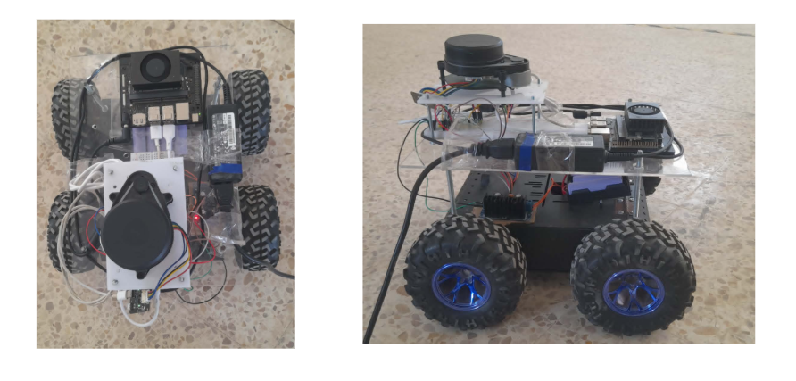

# Autonomous and Cooperative Multi-Robot Navigation Using Deep Reinforcement Learning

**Domain:** Autonomous Robotics | Deep Reinforcement Learning | Multi-Agent Systems | Embedded Systems

## 1. Project Overview

This project focuses on the design, development, and deployment of an autonomous mobile robot navigation system using Deep Reinforcement Learning.

The work was conducted in two phases:

- **Single-Agent Navigation:** Training a navigation policy using Proximal Policy Optimization (PPO), an actor–critic reinforcement learning algorithm.
- **Cooperative Multi-Agent Navigation:** Developing and evaluating a Multi-Agent PPO (MAPPO) approach for cooperative navigation in simulation.

The project covers the complete robotics pipeline, from simulation and policy training to physical robot design, hardware integration, and real-world deployment.

The trained PPO policy was deployed on the physical robot to evaluate sim-to-real transfer, achieving a **90% navigation success rate during real-world testing**.

## 2. Physical Robot Platform

### Robot Overview

The physical robot was designed, assembled, and wired from scratch, including its mechanical platform, motors, motor drivers, power supply, sensors, and embedded computing hardware.

<!-- Replace the image path with the actual image filename in your repository. -->

*Figure 1. Physical mobile robot developed for autonomous navigation.*

### Hardware Components

| Component | Function |
|---|---|
| NVIDIA Jetson Orin Nano | Onboard computing and execution of the trained PPO policy |
| YDLIDAR X4 | Laser scanning for obstacle perception and motion estimation |
| Raspberry Pi Pico | Low-level hardware interface running micro-ROS |
| Motor drivers | Control of the robot's motors |
| DC motors | Robot locomotion |
| Power supply | Power distribution to the robot's electronic components |

### Position Estimation

The system uses the `rf2o_laser_odometry` ROS 2 package to estimate robot motion from consecutive LiDAR scans.

The resulting odometry information supports robot localization and navigation without relying on an IMU.

## 3. Software Architecture and Technologies

- **Programming Languages:** Python, C/C++
- **Robotics Middleware:** ROS 2
- **Simulation Environment:** Gazebo Ignition Fortress
- **Deep Reinforcement Learning:** PPO, MAPPO
- **Learning Architecture:** Actor–Critic
- **Laser Odometry:** RF2O Laser Odometry
- **Sensors:** YDLIDAR X4
- **Embedded Systems:** NVIDIA Jetson Orin Nano, Raspberry Pi Pico, micro-ROS

## 4. Autonomous Navigation Using PPO

Proximal Policy Optimization (PPO) was implemented to train a single robot to navigate autonomously toward a target while avoiding obstacles.

The policy was trained in simulation using LiDAR-based observations and odometry information. The trained policy was subsequently deployed on the physical robot.

### PPO — Simulation Tests

The following demonstrations present the robot's navigation behavior in the simulated environment.

- [Simulation Test 01 — Autonomous Navigation](demo/ppo_simulation.mp4)

### PPO — Real Robot Tests

The trained PPO policy was evaluated on the physical robot to assess its ability to transfer learned navigation behavior from simulation to the real world.

- [Real Robot Test 01](demo/ppo_real_robot_test_01.mp4)
- [Real Robot Test 02](demo/ppo_real_robot_test_02.mp4)
- [Real Robot Test 03](demo/ppo_real_robot_test_03.mp4)

*Additional test videos can be added as further demonstrations of real-world performance.*

## 5. Cooperative Multi-Robot Navigation Using MAPPO

Multi-Agent Proximal Policy Optimization (MAPPO) was implemented to investigate cooperative navigation involving multiple mobile robots.

The approach uses centralized training with decentralized execution (CTDE), enabling agents to learn cooperative behavior during training while maintaining individual policies for execution.

### MAPPO — Simulation Tests

The following demonstrations present multi-robot navigation and coordination in simulation.

- [MAPPO Simulation Test 01 — Cooperative Navigation](demo/mappo_multi_robot_simulation_01.mp4)
- [MAPPO Simulation Test 02 — Multi-Robot Coordination](demo/mappo_multi_robot_simulation_02.mp4)
- [MAPPO Simulation Test 03 — Additional Scenario](demo/mappo_multi_robot_simulation_03.mp4)

**Scope:** MAPPO was evaluated in simulation. Physical multi-robot deployment was not included in the validated results.

## 6. Experimental Results

| Experiment | Environment | Result |
|---|---|---|
| PPO autonomous navigation | Simulation | Evaluated through navigation trials |
| PPO policy deployment | Physical robot | 90% navigation success rate |
| MAPPO cooperative navigation | Multi-robot simulation | Evaluated through simulation trials |

The real-world results demonstrate the feasibility of transferring a simulation-trained PPO navigation policy to a physical mobile robot.

The MAPPO experiments provide a basis for studying cooperative navigation and multi-agent coordination in simulated environments.

## 7. Project Demonstrations

Explore the videos to observe the robot's behavior under different conditions:

- **Physical Robot:** Hardware platform and real-world navigation.
- **PPO:** Single-agent autonomous navigation in simulation and on the physical robot.
- **MAPPO:** Cooperative multi-robot navigation in simulation.

## 8. Repository Contents

This public repository is intended as a project portfolio showcasing the system architecture, hardware implementation, and experimental demonstrations.

The source code is not included.

---
  
**Author:** Eya Ayedi  
**Specialization:** Industrial Computer Engineering, Robotics and Artificial Intelligence
